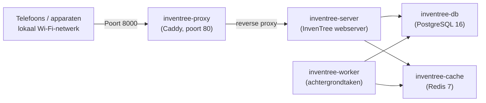

# VIVES_voorraad

Voorraadbeheer-systeem voor **Netwerk Experience '26-'27**, gebouwd op [InvenTree](https://inventree.org) en gedocumenteerd in dit project. De toepassing draait volledig in Docker-containers en is bereikbaar op het lokale netwerk.

## Architectuur



### Diensten

| Service            | Image                        | Functie                                               |
| ------------------ | ---------------------------- | ----------------------------------------------------- |
| `inventree-db`     | `postgres:16`                | Relatie-database voor InvenTree                       |
| `inventree-cache`  | `redis:7-alpine`             | Cache                                                 |
| `inventree-server` | `inventree/inventree:stable` | InvenTree webserver                                   |
| `inventree-worker` | `inventree/inventree:stable` | Achtergrond-worker (`invoke worker`)                  |
| `inventree-proxy`  | `caddy:2-alpine`             | Reverse proxy, publiceert poort **8000** op de host   |

### Data

Alle persistente data (database, media, statische bestanden, logs) ligt in één volume:

```
/opt/inventree/data        (INVENTREE_EXT_VOLUME)
├── pgdata/                → PostgreSQL-data
├── static/                → statische bestanden
├── media/                 → media-bestanden
└── ...
```

## Verplichte vereisten

- Een server met een **statisch IP-adres** op het lokale netwerk (bijv. `10.20.225.77`)
- [Docker](https://docs.docker.com/get-docker/) en Docker Compose geïnstalleerd op de server
- Firewallregels die **poort 8000** openzetten voor lokaal netwerkverkeer

## Opstarten

1. De repository klonen naar de server:

   ```bash
   git clone <repo-url> && cd VIVES_voorraad
   ```

2. Het `.env`-bestand aanmaken op basis van het template hieronder (`cp .env.example .env`) en de waarden aanpassen.

3. De containers starten:

   ```bash
   docker compose up -d
   ```

4. Status controleren:

   ```bash
   docker compose ps
   docker compose logs -f inventree-server
   ```

## Configuratie

### `.env`

De `.env` is opgenomen in de `.gitignore` omdat die gevoelige gegevens bevat. Template:

```ini
--- Algemene instellingen ---
# Docker-image tag van InvenTree
INVENTREE_TAG=stable
# Pad waar de persistente data op de host ligt
INVENTREE_EXT_VOLUME=/opt/inventree/data
# Externe URL van de server (IP + poort) → bepaalt ook de Base URL
INVENTREE_SITE_URL=http://10.20.225.77:8000/
INVENTREE_LOG_LEVEL=WARNING
INVENTREE_DEBUG=False

--- Database instellingen ---
INVENTREE_DB_ENGINE=postgresql
INVENTREE_DB_NAME=inventree
INVENTREE_DB_USER=pguser
INVENTREE_DB_PASSWORD=<sterk-wachtwoord>
INVENTREE_DB_HOST=inventree-db
INVENTREE_DB_PORT=5432

--- Cache (Redis) instellingen ---
INVENTREE_CACHE_HOST=inventree-cache
INVENTREE_CACHE_PORT=6379

--- Beheerder ---
INVENTREE_ADMIN_USER=admin
INVENTREE_ADMIN_PASSWORD=<sterk-wachtwoord>
INVENTREE_ADMIN_EMAIL=<beheerders-e-mail>
```

| Variabele            | Omschrijving                                                                                                                                          |
| -------------------- | ----------------------------------------------------------------------------------------------------------------------------------------------------- |
| `INVENTREE_TAG`      | Image-tag van InvenTree (standaard: `stable`)                                                                                                         |
| `INVENTREE_EXT_VOLUME` | Host-pad voor alle persistente data                                                                                                                |
| `INVENTREE_SITE_URL` | URL waarmee de server extern bereikbaar is. Dit **vergrendelt** de globale Base URL-instelling in InvenTree op dezelfde waarde                         |
| `INVENTREE_ADMIN_*`  | Inloggegevens van de eerste beheerder (wordt alleen aangemaakt bij de eerste start)                                                                    |
| `INVENTREE_DB_*`     | Verbinding met de PostgreSQL-container                                                                                                                |
| `INVENTREE_CACHE_*`  | Verbinding met de Redis-container                                                                                                                     |

### Netwerk en poorten

| Niveau                    | Poort | Uitleg                                                                   |
| ------------------------- | ----- | ------------------------------------------------------------------------ |
| Host (buiten)             | 8000  | Gepubliceerd door `inventree-proxy`, bereikbaar voor het lokaal netwerk   |
| Caddy-container           | 80    | Intern, proxy luistert hierop                                            |
| InvenTree-server          | 8000  | Intern, gunicorn luistert hierop                                         |

In de `Caddyfile` wordt alles op poort 80 geëindigd: `/static/*` en `/media/*` worden rechtstreeks geserveerd vanuit de mounted volumes, alles andere wordt doorgestuurd naar `inventree-server:8000`.

### Base URL in InvenTree

De **Base URL** (globale instelling `INVENTREE_BASE_URL`) wordt automatisch afgeleid van `INVENTREE_SITE_URL` en is daarom in de UI read-only:

- `INVENTREE_SITE_URL=http://10.20.225.77:8000/` → Base URL `http://10.20.225.77:8000`
- Om de Base URL te veranderen: `INVENTREE_SITE_URL` aanpassen in `.env` en de containers herstarten met `docker compose up -d`.

## Toegang

- **Web-UI:** `http://10.20.225.77:8000` (of het IP van de server)
- **Inloggen:** met de beheerdersgebruikersnaam en -wachtwoord uit `INVENTREE_ADMIN_USER` / `INVENTREE_ADMIN_PASSWORD`
- **API:** `http://10.20.225.77:8000/api/` (bijv. versie-info op `GET /api/`)

> Apparaten op het lokale Wi-Fi-netwerk kunnen direct verbinding maken; voor externe toegang moeten de poort en firewall apart geconfigureerd worden.

## Handige commands

```bash
# Containers (her)starten
docker compose up -d

# Alle containers stoppen
docker compose down

# Logs van een specifieke dienst
docker compose logs -f inventree-server

# In de InvenTree-cli stappen (bijv. settings)
docker compose exec inventree-server inventree shell

# Update naar nieuwere InvenTree (na INVENTREE_TAG wijzigen)
docker compose pull && docker compose up -d
```

## Troubleshooting

| Symptoom                                    | Oorzaak / oplossing                                                                |
| ------------------------------------------- | ---------------------------------------------------------------------------------- |
| Apparaten komen niet op poort 8000 binnen   | Firewall van de server: poort 8000 openzetten voor lokaal netwerkverkeer           |
| "Site URL is locked by configuration"       | Base URL volgt `INVENTREE_SITE_URL` uit `.env` — daar wijzigen, niet in de UI      |
| Server start niet na wijziging `.env`       | `docker compose up -d` opnieuw draaien zodat de nieuwe env vars geladen worden     |
| Oude versie na `docker compose pull`        | Oud image verwijderen met `docker image prune` en opnieuw opstarten                |

## Bestanden

```
VIVES_voorraad/
├── Caddyfile          # Config van de Caddy reverse proxy
├── docker-compose.yml # Definitie van alle diensten
├── .env.example       # Template voor .env (mag wel in git)
├── .env               # Lokaal config-bestand (niet in git, bevat geheimen)
└── README.md          # Dit bestand
```
